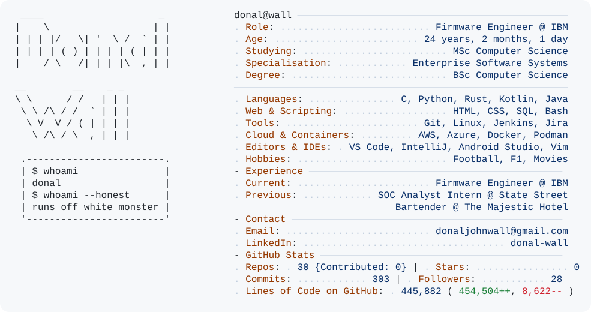

<a href="https://github.com/donalwall207">
  <picture>
    <source media="(prefers-color-scheme: dark)" srcset="dark_mode.svg">
    <source media="(prefers-color-scheme: light)" srcset="light_mode.svg">
    
  </picture>
</a>

  
  
  
  <!-- X / Twitter: put your handle in both places below, then delete these comment markers
  
  -->

<h3 align="center">🏆 Trophies</h3>

  <picture>
    <source media="(prefers-color-scheme: dark)" srcset="cards/trophies_dark.svg">
    
  </picture>

<h3 align="center">📊 GitHub Stats</h3>

  <picture>
    <source media="(prefers-color-scheme: dark)" srcset="cards/stats_dark.svg">
    
  </picture>
  <picture>
    <source media="(prefers-color-scheme: dark)" srcset="cards/langs_dark.svg">
    
  </picture>

  <picture>
    <source media="(prefers-color-scheme: dark)" srcset="cards/streak_dark.svg">
    
  </picture>

<h3 align="center">🛠️ Languages and Tools</h3>

                                  

